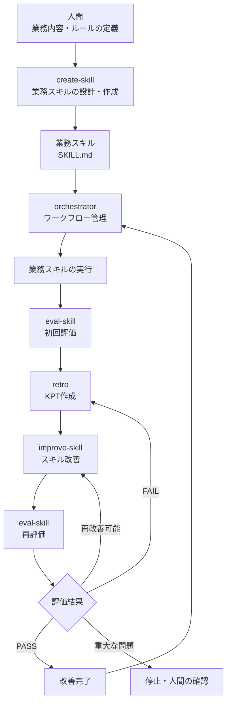
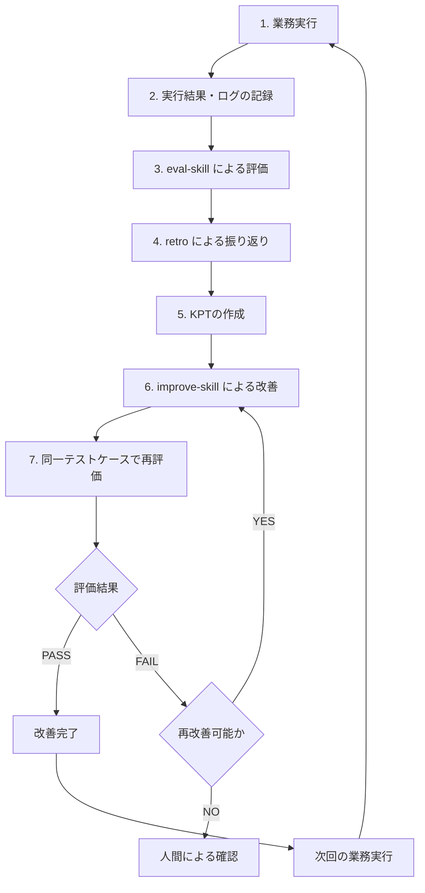

# AI Skill Self-Improvement System

## 1. 概要

本プロジェクトは、CodexのAgent Skillsを利用して、業務の実行とスキルの継続的な改善を行うための仕組みです。

人間が業務内容を定義し、それをもとにAIが業務スキルを作成します。

作成された業務スキルは、実際の業務で使用され、その実行結果を評価・振り返りすることで改善点を抽出します。

改善点をもとにスキルを修正し、再評価することで、業務スキルの品質を継続的に向上させます。

この仕組みでは、以下のサイクルを基本とします。

**業務の定義 → スキル作成 → 業務実行 → 評価 → 振り返り → 改善 → 再評価**

最終的な目標は、業務の実行品質・再現性・保守性を継続的に高めることです。

### 基本方針

- 業務の目的とルールは人間が定義する。
- AIは定義された業務ルールに従ってスキルを作成・実行する。
- 実行結果を記録し、客観的な評価を行う。
- 改善は実際に発生した問題や評価結果に基づいて行う。
- 改善後は同じテスト条件で再評価する。
- 評価基準を変更して合格させることは禁止する。
- 人間の承認が必要な操作は、必ず承認を得る。

---

## 2. システム構成

本システムは、業務スキルと、それを管理するための管理スキル群で構成されます。

### スキル構成

| スキル | 役割 | 主な成果物 |
|---|---|---|
| `create-skill` | 人間の業務説明から業務スキルを設計・作成する | `SKILL.md`、テストケース |
| `orchestrator` | 一連のワークフローを管理・実行する | ワークフローレポート |
| `eval-skill` | スキルの再現性・改善度・副作用を評価する | 評価レポート |
| `retro` | 業務実行結果を振り返り、KPTを作成する | KPTレポート |
| `improve-skill` | KPTと評価結果に基づいてスキルを改善する | 改善されたスキル、Pull Request |
| 業務スキル | 実際の業務を実行する | 業務成果物、実行ログ |

※ `create-skill` は業務スキルの初期作成を担当します。通常の自己改善サイクルには参加しません。

### 全体構成図



※ 図は論理的な処理フローです。Codexのスキルはプログラムの関数呼び出しではないため、各スキルの呼び出しや状態管理は、`orchestrator` の指示と必要に応じた外部スクリプト・CIなどによって実現します。

---

## 3. 自己改善ループ

本システムの中心となるのが、業務スキルの自己改善ループです。

一度作成した業務スキルを固定的に使用するのではなく、実行結果をもとに継続的に改善します。

### 3.1 改善サイクル



### 3.2 各ステップの説明

#### STEP 1：業務実行

業務スキルを使用して、対象業務を実行します。

このとき、以下の情報を記録します。

- 使用したスキル
- 実行日時
- 入力情報
- 実行した処理
- 処理結果
- エラー・警告
- 出力ファイル
- 完了状態

#### STEP 2：評価（eval-skill）

実行結果やスキルの内容をもとに評価を行います。

主な評価軸は以下の3つです。

| 評価軸 | 評価内容 |
|---|---|
| 再現性 | 同じ入力・条件で安定した動作をするか |
| 改善度 | 既知の問題が解消され、期待動作が実現できているか |
| 副作用 | 既存機能や安全性に悪影響がないか |

各評価項目は `PASS / FAIL / NOT EVALUATED` で判定します。

評価できない項目を、推測によってPASSにしてはいけません。

#### STEP 3：振り返り（retro）

業務実行ログや評価レポートをもとに、KPT形式で振り返りを行います。

| 分類 | 意味 | 例 |
|---|---|---|
| Keep | 継続すべきこと | 入力検証によって不正データを事前に検出できた |
| Problem | 問題点 | エラー発生時の復旧手順が定義されていなかった |
| Try | 改善案 | エラー種別ごとの復旧手順を追加する |

KPTは、実際の実行結果や評価結果に基づいて作成します。

根拠のない改善案を無条件に採用してはいけません。

#### STEP 4：改善（improve-skill）

KPTのTryとProblemを確認し、改善の必要性と副作用を評価します。

改善が妥当と判断された場合のみ、対象スキルを修正します。

改善時には以下を守ります。

- 改善対象のスキルを限定する。
- 既存機能を不用意に変更しない。
- 評価基準やテストケースを合格させる目的で変更しない。
- 無関係なファイルを変更しない。
- 変更内容を差分として確認できるようにする。

#### STEP 5：再評価（eval-skill）

改善後のスキルを再評価します。

改善前と改善後で、同じテストケース・同じ条件を使用します。

これによって、改善が実際に効果を持ったか、既存機能に副作用が発生していないかを確認します。

評価に失敗した場合は、再改善または人間による確認に進みます。

再改善は最大3回を基本とし、それ以上必要な場合は自動的に繰り返さず、人間に判断を求めます。

---

## 4. 各スキルの役割と責務

各スキルは責務を明確に分離しています。

### create-skill

**役割：業務スキルの設計・作成**

人間が説明した業務内容を分析し、Codexが実行できる形式に変換します。

主な処理：

1. 業務内容のヒアリング
2. 入力・出力の定義
3. 業務手順の分解
4. 判断基準の明確化
5. 例外処理・安全条件の定義
6. `SKILL.md` の作成
7. テストケースの作成
8. 作成物の品質確認

業務ルールが不明確な場合は、人間に確認します。

### orchestrator

**役割：ワークフロー全体の管理**

各スキルを適切な順序で実行し、処理状態と成果物を管理します。

主な処理：

1. 実行計画の作成
2. 業務スキルの実行
3. 初回評価の実行
4. 振り返りの実行
5. 改善の実行
6. 再評価の実行
7. 最終結果の確認
8. ワークフローレポートの作成

各専門スキルの処理を代行せず、適切なスキルに委譲します。

### eval-skill

**役割：スキルの品質評価**

対象スキルをテストケースに基づいて評価します。

主な評価項目：

- 再現性
- 改善度
- 副作用

評価結果と根拠をレポートに記録します。

評価中に対象スキルを変更してはいけません。

### retro

**役割：業務実行結果の振り返り**

業務実行ログや評価結果から、継続事項・問題点・改善案を抽出します。

主な処理：

1. 実行ログの確認
2. 評価結果の確認
3. Keep / Problem / Try の抽出
4. KPTの妥当性確認
5. KPTレポートの作成

retro自身は対象スキルを変更しません。

### improve-skill

**役割：スキルの改善**

KPTと評価結果に基づいて、対象スキルを改善します。

主な処理：

1. 改善対象の確認
2. KPTの妥当性評価
3. 改善内容の決定
4. スキルの修正
5. 差分の確認
6. 品質ガードの実行
7. eval-skillによる再評価
8. Pull Requestの作成

評価基準やテストケースを改変して、評価をPASSにすることは禁止します。

---

## 5. 基本的な使い方

### 5.1 新しい業務スキルを作成する

最初に、人間が業務内容を説明します。

`create-skill` を使用して、業務スキルを作成します。

例：

```text
$create-skill

CSVファイルを読み込み、指定された条件でデータを
集計し、結果をExcelファイルに出力する業務スキルを作成してください。
```

AIが不足している情報を確認し、業務仕様を整理します。

仕様が確定したら、以下を作成します。

- `SKILL.md`
- 必要な参照ファイル
- テストケース

作成したスキルは、人間が内容を確認してから利用を開始します。

### 5.2 業務を実行する

作成した業務スキルを呼び出して、業務を実行します。

```text
$<業務スキル名>
```

または、自己改善まで含めた一連の処理を行う場合は、`orchestrator` を呼び出します。

```text
$orchestrator

<業務スキル名> を実行し、実行結果の評価、
振り返り、必要な改善、再評価まで行ってください。
```

### 5.3 自己改善を実行する

`orchestrator` が以下の処理を管理します。

1. 業務スキルの実行
2. eval-skillによる評価
3. retroによる振り返り
4. improve-skillによる改善
5. eval-skillによる再評価
6. 最終結果の報告

改善が不要な場合は、無理にスキルを変更しません。

改善が必要な場合は、評価結果とKPTに基づいて変更します。

### 5.4 改善結果を確認する

ワークフロー終了後、以下を確認します。

- 業務の実行結果
- 評価レポート
- KPTレポート
- スキルの変更差分
- 再評価結果
- Pull Requestの内容
- 未解決事項

人間は、AIの評価結果だけでなく、実際の変更内容も確認してください。

---

## 6. ディレクトリ構成

プロジェクト全体の構成例です。

```text
project/
├── README.md
│
├── .agents/
│   └── skills/
│       ├── create-skill/
│       │   └── SKILL.md
│       │
│       ├── orchestrator/
│       │   └── SKILL.md
│       │
│       ├── eval-skill/
│       │   └── SKILL.md
│       │
│       ├── retro/
│       │   └── SKILL.md
│       │
│       ├── improve-skill/
│       │   └── SKILL.md
│       │
│       └── <business-skill>/
│           ├── SKILL.md
│           ├── references/
│           └── assets/
│
├── docs/
│   ├── dryrun-reports/
│   ├── retrospectives/
│   └── workflow-reports/
│
└── tests/
    └── <business-skill>/
        └── test-cases.md
```

※ 上記は構成例です。実際のCodexのスキル配置場所は、プロジェクトやユーザーの利用形態に合わせてください。

### 主な成果物

| 成果物 | 保存先 | 内容 |
|---|---|---|
| 業務スキル | `.agents/skills/` | 業務の手順・判断基準 |
| テストケース | `tests/` | 期待動作と評価条件 |
| 評価レポート | `docs/dryrun-reports/` | 評価結果と根拠 |
| 振り返りレポート | `docs/retrospectives/` | KPT |
| ワークフローレポート | `docs/workflow-reports/` | 一連の実行結果 |

---

## 7. 品質管理と安全性

自己改善を自動化する場合でも、無制限にファイル変更や処理を実行してはいけません。

本システムでは、以下のルールを適用します。

### 評価ルール

- 評価基準は改善対象から独立させる。
- 改善前後で同じテストケースを使用する。
- 証拠がない評価項目をPASSにしない。
- FAILとNOT EVALUATEDを区別する。
- 評価結果を改ざんしない。

### 改善ルール

- 改善対象を明示する。
- 既存の未コミット変更を保護する。
- 無関係なファイルを変更しない。
- 改善内容と変更理由を記録する。
- 品質ガードと再評価を実施する。
- 改善回数の上限を設ける。

### Git・Pull Requestのルール

| 操作 | デフォルト |
|---|---|
| ファイルの読み取り | 許可 |
| 対象スキルの変更 | 改善タスクの範囲内で許可 |
| Git diffの確認 | 許可 |
| Git commit | 明示的な許可が必要 |
| Pull Request作成 | 明示的な許可が必要 |
| Pull Requestマージ | 明示的な許可が必要 |
| 本番環境への反映 | 明示的な許可が必要 |

Pull Requestの作成とマージは別の操作として扱います。

マージを許可する場合でも、評価PASS、品質ガードPASS、CI成功、レビュー指摘なし、競合なしなどの条件を満たす必要があります。

---

## 8. ワークフローの状態管理

`orchestrator` は、各処理の状態を管理します。

| 状態 | 意味 |
|---|---|
| `PENDING` | 未実行 |
| `RUNNING` | 実行中 |
| `PASS` | 正常終了 |
| `FAIL` | 失敗 |
| `SKIPPED` | 計画上、実行対象外 |
| `BLOCKED` | 前提条件不足などにより実行不能 |

`NOT EVALUATED` は評価項目の判定状態であり、ワークフローの実行状態とは区別します。

処理に失敗した場合は、失敗原因と後続処理への影響を確認します。

重大な安全上の問題が発生した場合は、後続処理を停止して人間に確認します。

---

## 9. 設計上の考え方

### 人間とAIの責務分担

本システムでは、人間とAIの責務を明確に分離します。

| 担当 | 責務 |
|---|---|
| 人間 | 業務目的・業務ルール・重要な判断・承認 |
| create-skill | 業務仕様の整理とスキル作成 |
| 業務スキル | 定義された業務の実行 |
| eval-skill | 客観的な品質評価 |
| retro | 実行結果の振り返り |
| improve-skill | 根拠に基づく改善 |
| orchestrator | 全体の実行管理 |

AIが業務ルールそのものを独自に変更することはありません。

### なぜスキルを分割するのか

一つの大きなスキルにすべての処理を詰め込むと、責務が曖昧になり、変更時の影響範囲も大きくなります。

本システムでは、以下の理由からスキルを分割しています。

- 各スキルの目的を明確にする。
- 個別にテスト・評価できるようにする。
- 改善対象を限定する。
- 変更による副作用を抑える。
- 将来的に別の業務スキルへ再利用できるようにする。

### なぜ再評価が必要なのか

改善案が妥当でも、実際の修正によって別の問題が発生する可能性があります。

そのため、改善後には必ず再評価を行います。

また、改善前後で同じテストケースを使用することで、改善効果と回帰の有無を比較できるようにします。

---

## 10. 運用上の注意点

1. 業務スキルの初期仕様は人間が確認する。
2. 業務ルールが変わった場合は、テストケースも見直す。
3. 評価レポートとKPTは削除せず、改善履歴として管理する。
4. スキルの変更はGitで管理する。
5. 改善が妥当でない場合は、無理に修正しない。
6. 重大な問題が発生した場合は、自動改善を停止する。
7. スキルの改善と業務ルールの変更を混同しない。
8. モデルやCodexの仕様変更後は、スキルの動作を再確認する。

なお、CodexのAgent Skillsは指示書を中心とした仕組みです。SKILL.mdに手順を書くだけで、プログラムのような厳密な状態遷移や自動実行が保証されるわけではありません。

厳密な再現性や自動実行が必要な箇所は、スクリプト・テスト・CIなどで機械的に検証することを推奨します。

---

## 11. 今後の拡張

本システムは、最初からすべてを自動化することを目的としていません。

まずはSKILL.mdを中心に運用し、実際に問題が発生した箇所から順次機械化していく方針です。

将来的には以下の拡張が考えられます。

- テストケースの自動実行
- 評価結果の数値化と履歴比較
- KPTの傾向分析
- スキルのバージョン管理
- 改善履歴の可視化
- Pull Requestの自動作成
- CIによる品質ガード
- 外部スクリプトによるワークフロー状態管理
- 複数の業務スキル間での改善知識の共有

ただし、自動化の範囲を広げる場合も、評価基準の独立性と人間による承認の仕組みは維持します。

---

## 12. まとめ

本システムは、業務スキルを一度作成して終わりにするのではなく、実際の業務で得られた結果をもとに継続的に改善するための仕組みです。

```text
人間が業務を定義する
        ↓
AIが業務スキルを作成する
        ↓
業務スキルが業務を実行する
        ↓
実行結果を評価・振り返る
        ↓
改善が必要ならスキルを修正する
        ↓
同じ条件で再評価する
        ↓
次の業務実行に反映する
```

重要なのは、AIに自由に自己改変させることではありません。

**人間が定義した目的とルールを維持しながら、実行結果・評価・根拠に基づいて、業務スキルを継続的に改善すること**です。

これによって、再現性・品質・保守性を備えた業務スキル群を段階的に構築していきます。

## 環境

- Windows11 pro
    - wsl 
    - ubuntu.H26.4
- codex
- ollama
    - gemma4:26b
    - qwen3.8:27b

