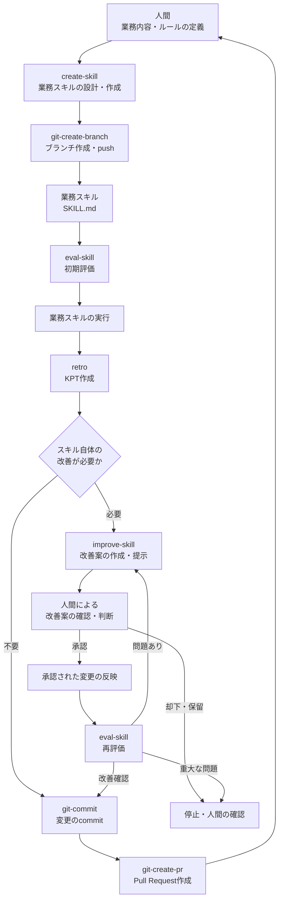
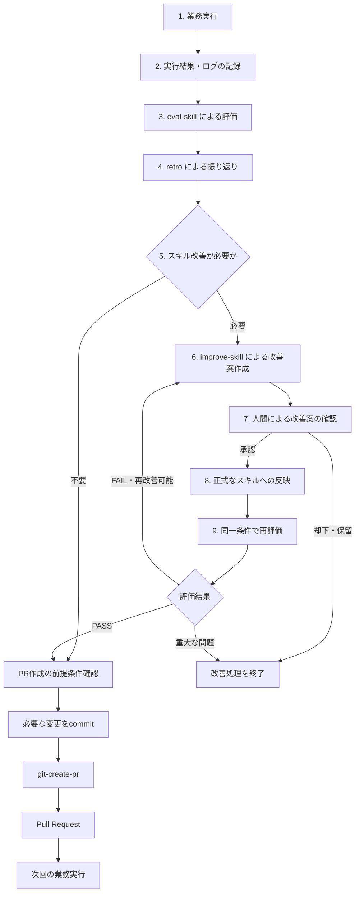
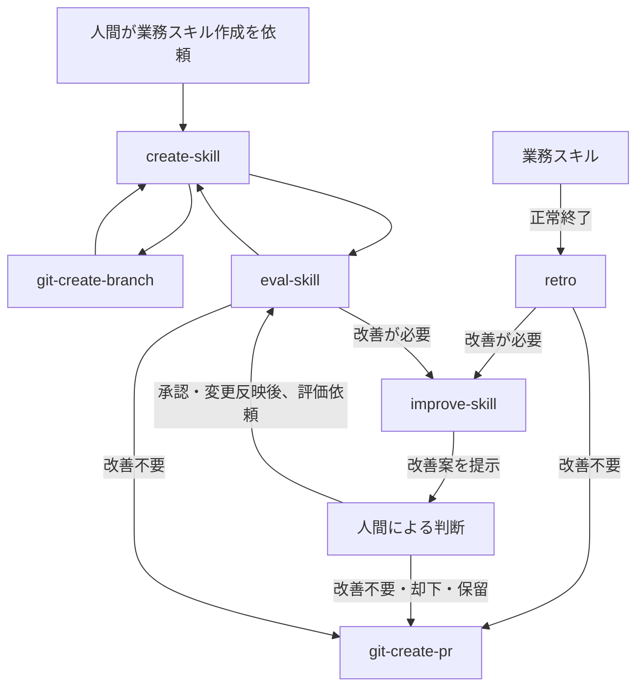

# AI Skill Self-Improvement System

## 1. 概要

本プロジェクトは、Codex の Agent Skills を利用して、業務の実行と業務スキルの継続的な改善を行うための仕組みです。

人間が業務の目的・ルール・制約を定義し、それをもとにAIが業務スキルを設計・作成します。

作成された業務スキルは、実際の業務で使用されます。その実行結果を評価・振り返りすることで問題点や改善案を抽出し、必要に応じてスキルの改善案を作成します。

この仕組みでは、以下のサイクルを基本とします。

**業務の定義 → スキル作成 → 業務実行 → 評価 → 振り返り → 改善案の作成  → 再評価**

最終的な目標は、業務の実行品質・再現性・保守性を継続的に高めることです。

### 基本方針

- 業務の目的・業務ルール・重要な判断基準は人間が定義する。
- AIは定義された業務ルールに従ってスキルを設計・作成・実行する。
- 実行結果とログを記録し、根拠に基づいて評価する。
- 改善は、実際に発生した問題や評価結果に基づいて検討する。
- 改善案の作成と正式なスキルへの反映を分離する。
- 改善案を正式なスキルに反映する前に、人間が確認・判断する。
- 改善前後の評価では、原則として同じテスト条件を使用する。
- 評価基準やテストケースを変更して、意図的に合格させることは禁止する。
- Git操作では既存のユーザー変更を保護し、勝手に破棄・上書きしない。
- Git操作に失敗した場合は、エラーを明示して停止する。
- commit、Pull Request作成、mergeなどの操作は、それぞれの責務を持つスキルに分離する。
- 人間の承認が必要な操作は、必ず承認を得る。

---

## 2. システム構成

本システムは、業務スキルと、それを作成・評価・改善する管理スキル群で構成されます。

### 2.1 スキル構成

| スキル | 役割 | 主な成果物 |
|---|---|---|
| `create-skill` | 人間の業務説明から業務スキルを設計・作成する | `SKILL.md`、テストケース |
| `orchestrator` | 複数スキルの呼び出しとワークフロー全体を管理する | ワークフローレポート |
| `eval-skill` | スキルの再現性・改善度・副作用を評価する | 評価レポート |
| `retro` | 業務実行結果を振り返り、KPTを作成する | KPTレポート |
| `improve-skill` | KPTと評価結果を分析し、スキルの改善案を作成する | 改善提案、変更案 |
| `git-create-branch` | 作業ブランチを作成し、リモートへpushする | Gitブランチ |
| `git-commit` | 変更内容を確認し、commitする | Git commit |
| `git-create-pr` | GitHub Pull Requestを作成する | Pull Request |
| 業務スキル | 実際の業務を実行する | 業務成果物、実行ログ |

各スキルは独立した責務を持ちます。

特に、スキルの改善処理とGit操作は分離します。

- `improve-skill` は改善案を作成・提示する。
- 正式なスキルへの変更反映は、人間の判断を経て行う。
- `git-create-branch` はブランチ作成とpushを担当する。
- `git-commit` はcommitを担当する。
- `git-create-pr` はPull Request作成を担当する。
- mergeはPull Request作成とは別の操作として扱う。

各スキルから後続スキルを呼び出す場合は、呼び出し元が把握している情報を明示的に引き渡します。呼び出し先は、すでに渡された情報を重複して質問しません。

### 2.2 全体構成図



※ 図は論理的な処理フローです。実際のスキル呼び出しや状態管理は、`orchestrator` の指示と各スキルの責務に従って実行します。

※ 上図のcommit・PRへの移行は、必要な変更が承認・反映され、Git操作の前提条件を満たした場合に限ります。

※ `retro` のKPTレポートなど、新たに作成された未コミットファイルが存在する場合、`git-create-pr` をそのまま実行することはできません。必要な変更を確認・commitしてからPR作成に進みます。

---

## 3. 自己改善ループ

本システムの中心となるのが、業務スキルの自己改善ループです。

一度作成した業務スキルを固定的に使用するのではなく、実際の業務実行結果や評価結果をもとに改善を検討します。

ただし、AIが正式なスキルを無断で変更することはありません。改善案の作成と正式な変更の反映は分離します。

### 3.1 基本的な改善サイクル



### 3.2 スキル間の呼び出しフロー

各スキルの役割と呼び出し関係は、次のように整理します。



このフローの考え方は以下のとおりです。

| 呼び出し元 | 条件 | 呼び出し先 |
|---|---|---|
| `create-skill` | 作業ブランチが必要 | `git-create-branch` |
| `create-skill` | スキル作成後の評価が必要 | `eval-skill` |
| 業務スキル | 正常終了後の振り返り | `retro` |
| `retro` | スキル自体の改善が必要 | `improve-skill` |
| `retro` | スキル自体の改善が不要 | `git-create-pr` |
| `improve-skill` | 改善案を人間が承認し、評価が必要 | `eval-skill` |
| `eval-skill` | 改善が必要 | `improve-skill` |
| `eval-skill` | 改善不要 | `git-create-pr` |

※ `improve-skill` は改善案の提示で処理を終了します。人間の判断を経ずに正式なスキルを変更したり、Pull Requestを作成したりしません。

※ `retro` や `eval-skill` から後続スキルを呼び出す場合は、対象スキル名・レポートパス・判定理由など、必要な情報を引き渡します。

### 3.3 STEP 1：業務実行

業務スキルを使用して、対象業務を実行します。

可能な範囲で、以下の情報を記録します。

- 使用したスキル
- 実行日時
- 入力情報
- 実行した処理
- 処理結果
- エラー・警告
- 出力ファイル
- 完了状態

業務実行が失敗した場合や途中で中止された場合は、正常終了した実行と区別します。

失敗・中止した実行を、通常の成功実行と同じ前提で振り返り・評価してはいけません。ただし、人間から明示的に振り返りを依頼された場合は対象にできます。

### 3.4 STEP 2：評価（eval-skill）

`eval-skill` は、対象スキルの内容とテスト結果をもとに品質を評価します。

主な評価軸は以下の3つです。

| 評価軸 | 評価内容 |
|---|---|
| 再現性 | 同じ入力・条件で安定した動作をするか |
| 改善度 | 既知の問題が解消され、期待動作が実現できているか |
| 副作用 | 既存機能や安全性に悪影響がないか |

評価項目は以下のいずれかで判定します。

- `PASS`
- `FAIL`
- `NOT EVALUATED`

評価できない項目を、推測によってPASSにしてはいけません。

#### 疑似タスクの作成

`eval-skill` は、評価対象のスキルに対して、エージェント自身が3件の疑似タスクを作成します。

疑似タスクは、対象スキルの目的・入力・期待動作・制約を理解したうえで作成します。

3件の疑似タスクは、可能な範囲で異なる状況や入力条件を含めます。

作成した疑似タスクと期待結果を明示し、それぞれの実行結果を評価します。

評価対象のスキルを有利にする目的で、疑似タスクや期待結果を恣意的に変更してはいけません。

#### 評価結果の保存

評価結果は、対象スキルごとに管理します。

基本的な保存先は以下です。

```text
skill-development/
├── proposals/
│   └── <skill-name>/
│       └── <run-id>/
├── evaluations/
│   └── <skill-name>/
│       └── <run-id>/
└── reports/
    └── <skill-name>/
        └── <run-id>/
```

`run-id` は原則として `YYYYMMDD-HHMMSS` 形式とします。

評価レポートには、評価対象・評価条件・疑似タスク・期待結果・実行結果・判定根拠を記録します。

### 3.5 STEP 3：振り返り（retro）

`retro` は、業務実行ログや評価レポートをもとに、KPT形式で振り返りを行います。

| 分類 | 意味 | 例 |
|---|---|---|
| Keep | 継続すべきこと | 入力検証によって不正データを事前に検出できた |
| Problem | 問題点 | エラー発生時の復旧手順が定義されていなかった |
| Try | 改善案 | エラー種別ごとの復旧手順を追加する |

KPTは、実際の実行結果や評価結果に基づいて作成します。

根拠のない改善案を無条件に採用してはいけません。

#### KPTレポートの保存先

KPTレポートは、以下に保存します。

```text
docs/
└── retro-reports/
    └── <skill-name>/
        └── <datetime>.md
```

- `<skill-name>` は振り返り対象のスキル名。
- `<datetime>` はレポート作成時のローカル日時を使用する。
- ファイル名は `YYYYMMDD-HHMMSS.md` 形式を基本とする。
- 同じ名前のファイルが存在する場合は、連番を付けて上書きを避ける。

レポートには、実行概要・Keep・Problem・Try・改善要否・後続処理の結果を記録します。

#### 改善要否の判断

ProblemやTryが存在することだけを理由に、スキル自体の改善が必要と判断してはいけません。

業務上の一時的な問題、入力データの問題、環境依存の問題など、スキル自体の変更では解決しない事項を区別します。

- スキル自体の改善が必要な場合：`improve-skill` を呼び出す。
- スキル自体の改善が不要な場合：PR作成の前提条件を確認し、`git-create-pr` に進む。

ただし、KPTレポートが未コミットである場合は、`git-create-pr` を呼び出してはいけません。必要な変更を確認・commitした後にPR作成へ進みます。

### 3.6 STEP 4：改善案の作成（improve-skill）

`improve-skill` は、KPTと評価結果に基づいて、対象スキルの改善が必要かを分析します。

主な処理：

1. 改善対象の確認
2. KPTと評価結果の確認
3. Problemの原因分析
4. Tryの妥当性評価
5. 改善による副作用の検討
6. 改善案の作成
7. 変更対象と変更理由の明示
8. 改善提案の提示

`improve-skill` は、改善案の作成・提示までを担当します。

以下の操作を自動的に行ってはいけません。

- `.agents/` 配下の正式な `SKILL.md` の直接変更
- 人間の承認を得ない改善案の正式反映
- Git commit
- Pull Request作成
- Pull Requestのmerge

改善案には、少なくとも以下を含めます。

- 改善対象
- 発生した問題
- 問題の原因
- 改善方針
- 変更対象ファイル
- 期待される改善効果
- 想定される副作用
- 再評価が必要な項目

改善案を人間に提示した時点で、`improve-skill` の処理は終了します。

その後の正式な変更反映・再評価・PR作成は、人間の判断と後続ワークフローに従います。

### 3.7 STEP 5：再評価（eval-skill）

改善案が承認され、正式なスキルに反映された場合は、`eval-skill` で再評価します。

改善前後で、原則として同じテストケース・同じ条件を使用します。

これによって、改善が実際に効果を持ったか、既存機能に副作用が発生していないかを確認します。

再評価では、以下を確認します。

- 既知の問題が解消されているか。
- 期待した動作が実現されているか。
- 既存機能が維持されているか。
- 新しい問題や副作用が発生していないか。

評価に失敗した場合は、再改善または人間による確認に進みます。

再改善は最大3回を基本とし、それ以上必要な場合は自動的に繰り返さず、人間に判断を求めます。

評価基準を変更してPASSにすることは禁止します。

---

## 4. 各スキルの役割と責務

### 4.1 create-skill

**役割：業務スキルの設計・作成**

人間が説明した業務内容を分析し、Codexが実行できる形式に変換します。

主な処理：

1. 業務内容のヒアリング
2. 入力・出力の定義
3. 業務手順の分解
4. 判断基準の明確化
5. 例外処理・安全条件の定義
6. 作業ブランチの作成依頼
7. `SKILL.md` の作成
8. 必要な参照ファイル・テストケースの作成
9. `eval-skill` による評価依頼
10. 作成物の品質確認

業務ルールが不明確な場合は、人間に確認します。

ブランチ作成では、直接Gitコマンドを実行するのではなく、`git-create-branch` を使用します。

作成後の評価では、`eval-skill` を使用します。

### 4.2 orchestrator

**役割：ワークフロー全体の管理**

複数のスキルを適切な順序で呼び出し、処理状態と成果物を管理します。

主な処理：

1. 実行計画の作成
2. 対象スキルと前提条件の確認
3. 必要なスキルの呼び出し
4. 呼び出し元・呼び出し先間の情報引き渡し
5. 処理結果の確認
6. 後続処理の実行可否判断
7. 最終結果の確認
8. ワークフローレポートの作成

`orchestrator` は各専門スキルの処理を代行せず、適切なスキルに委譲します。

各スキルの実行結果を確認せずに、次の処理へ進んではいけません。

### 4.3 eval-skill

**役割：スキルの品質評価**

対象スキルを疑似タスクと評価基準に基づいて評価します。

主な処理：

1. 評価対象と評価条件の確認
2. 疑似タスク3件の作成
3. 期待結果の定義
4. 疑似タスクの実行
5. 再現性・改善度・副作用の評価
6. 評価根拠の記録
7. 評価レポートの作成
8. 後続処理の判定

評価中に正式な対象スキルを変更してはいけません。

評価基準やテストケースを、合格させる目的で変更してはいけません。

### 4.4 retro

**役割：業務実行結果の振り返り**

業務実行ログや評価結果から、継続事項・問題点・改善案を抽出します。

主な処理：

1. 実行ログの確認
2. 評価結果の確認
3. Keep / Problem / Try の抽出
4. KPTの妥当性確認
5. KPTレポートの作成
6. スキル自体の改善要否の判断
7. 必要な後続スキルの呼び出し
8. 後続処理の結果をレポートに記録

`retro` 自身は対象スキルを変更しません。

KPTレポートの保存先は `docs/retro-reports/<skill-name>/` とします。

改善が必要な場合は `improve-skill`、不要な場合はGitの前提条件を確認したうえで `git-create-pr` に処理を引き渡します。

### 4.5 improve-skill

**役割：スキルの改善案の作成**

KPTと評価結果に基づいて、対象スキルの改善案を作成します。

主な処理：

1. 改善対象の確認
2. KPTの妥当性評価
3. 問題の原因分析
4. 改善内容の検討
5. 副作用の検討
6. 改善提案の作成
7. 改善提案の提示

正式なスキルの変更、commit、PR作成、mergeは担当しません。

改善案を人間に提示した時点で処理を終了します。

### 4.6 git-create-branch

**役割：作業ブランチの作成とリモートへのpush**

Gitのブランチ作成処理を共通化します。

主な処理：

1. 作業内容の確認
2. 現在のブランチの確認
3. 未コミット変更の確認
4. 適切なブランチprefixの選択
5. ブランチ作成
6. リモートへのpush
7. 実行結果の報告

ブランチ名のprefixは、作業内容に応じて選択します。

代表例：

- `features`
- `fix`
- `refactor`
- `docs`
- `test`
- `chore`
- `hotfix`

これらは固定リストではありません。作業内容に適したprefixを選択します。

ブランチ名は、Issue番号がある場合は以下を基本とします。

```text
<prefix>/<issue-number>-<description>
```

Issue番号がない場合は以下とします。

```text
<prefix>/<description>
```

Issue番号は必須ではありません。

原則として `main` または `dev` を起点に作業ブランチを作成します。

未コミット変更が存在する場合は停止します。ユーザーの変更を勝手にstash・破棄してはいけません。

Git操作に失敗した場合は、失敗したコマンドとエラーを表示して停止し、ユーザーに手動対応を依頼します。

### 4.7 git-commit

**役割：変更内容の確認とGit commit**

変更内容を確認し、適切なcommit messageを作成してcommitするための共通スキルです。

主な処理：

1. 指定された変更記録・差分情報の確認
2. Gitの作業状態の確認
3. 変更内容の把握
4. 英語のcommit messageの作成・提示
5. commit対象の確認
6. commitの実行
7. commit結果の確認

ユーザーの意図しないファイルをcommitしてはいけません。

Git操作に失敗した場合は、失敗したコマンドとエラーを表示して停止し、ユーザーに手動対応を依頼します。

### 4.8 git-create-pr

**役割：GitHub Pull Requestの作成**

GitHub CLI（`gh`）を使用してPull Requestを作成します。

主な処理：

1. 現在のブランチの確認
2. Base BranchとHead Branchの確認
3. 未コミット変更の確認
4. リモートブランチの確認
5. 既存Pull Requestの確認
6. Git差分の確認
7. PR titleとbodyの作成
8. Pull Requestの作成
9. 作成結果の確認

PR titleとbodyは英語で作成します。

PRの内容は、実際のGit差分と実施結果に基づいて記述します。実施していないテストを実施済みとして記述してはいけません。

既存のPull Requestが存在する場合は、重複作成せず既存PRの情報を返します。

`git-create-pr` はcommit・push・mergeを担当しません。

未コミット変更がある場合は停止します。リモートにHead Branchが存在しない場合も、pushを勝手に実行せず、必要な対応を依頼します。

---

## 5. 基本的な使い方

### 5.1 新しい業務スキルを作成する

最初に、人間が業務内容を説明します。

`create-skill` を使用して、業務スキルを作成します。

例：

```text
$create-skill

CSVファイルを読み込み、指定された条件でデータを
集計し、結果をExcelファイルに出力する業務スキルを作成してください。
```

AIが不足している情報を確認し、業務仕様を整理します。

仕様が確定したら、作業ブランチを作成し、以下を作成します。

- `SKILL.md`
- 必要な参照ファイル
- テストケース

作成したスキルは `eval-skill` で評価します。

作成したスキルは、人間が内容を確認してから利用を開始します。

### 5.2 業務を実行する

作成した業務スキルを呼び出して、業務を実行します。

```text
$<業務スキル名>
```

業務スキルが正常終了した場合は、`retro` を使用して振り返りを行います。

### 5.3 振り返りを実行する

```text
$retro

直前の業務実行結果を振り返り、KPTレポートを作成してください。
```

`retro` は実行ログや評価結果を確認し、KPTレポートを作成します。

スキル自体の改善が必要な場合は `improve-skill` に引き渡します。

改善が不要な場合は、PR作成の前提条件を確認して `git-create-pr` に引き渡します。

### 5.4 改善案を作成する

```text
$improve-skill

対象スキルのKPTレポートと評価結果を確認し、
改善案を作成してください。
```

`improve-skill` は改善内容・変更対象・変更理由・期待効果・副作用を整理して提示します。

人間は改善案を確認し、正式なスキルに反映するか判断します。

改善案の提示だけで終了するため、承認されていない変更が自動的に正式なスキルへ反映されることはありません。

### 5.5 評価を実行する

```text
$eval-skill

対象スキルを評価してください。
```

`eval-skill` は3件の疑似タスクを作成し、評価を実施します。

評価結果に改善が必要な場合は `improve-skill` に引き渡します。

改善が不要な場合は、後続処理の前提条件を確認して `git-create-pr` に引き渡します。

### 5.6 Pull Requestを作成する

```text
$git-create-pr

現在の作業ブランチの変更内容からPull Requestを作成してください。
```

`git-create-pr` はGitの状態と差分を確認してPRを作成します。

ただし、以下の条件を満たしている必要があります。

- 作業ブランチが `main` / `dev` ではない。
- 未コミット変更がない。
- Head Branchがリモートに存在する。
- Base Branchを特定できる。
- 同じHead BranchとBase Branchの組み合わせで、未解決の既存PRがない。

条件を満たさない場合は停止し、必要な対応を明示します。

---

## 6. ディレクトリ構成

プロジェクト全体の構成例です。

```text
project/
├── README.md
│
├── .agents/
│   └── skills/
│       ├── create-skill/
│       │   └── SKILL.md
│       │
│       ├── orchestrator/
│       │   └── SKILL.md
│       │
│       ├── eval-skill/
│       │   └── SKILL.md
│       │
│       ├── retro/
│       │   └── SKILL.md
│       │
│       ├── improve-skill/
│       │   └── SKILL.md
│       │
│       ├── git-create-branch/
│       │   └── SKILL.md
│       │
│       ├── git-commit/
│       │   └── SKILL.md
│       │
│       ├── git-create-pr/
│       │   └── SKILL.md
│       │
│       └── <business-skill>/
│           ├── SKILL.md
│           ├── references/
│           └── assets/
│
├── docs/
│   ├── retro-reports/
│   │   └── <skill-name>/
│   │       └── <datetime>.md
│   │
│   └── workflow-reports/
│
├── skill-development/
│   ├── proposals/
│   │   └── <skill-name>/
│   │       └── <run-id>/
│   │
│   ├── evaluations/
│   │   └── <skill-name>/
│   │       └── <run-id>/
│   │
│   └── reports/
│       └── <skill-name>/
│           └── <run-id>/
│
└── tests/
    └── <business-skill>/
        └── test-cases.md
```

※ 上記は構成例です。実際のCodexのスキル配置場所は、プロジェクトやユーザーの利用形態に合わせてください。

### 主な成果物

| 成果物 | 保存先 | 内容 |
|---|---|---|
| 業務スキル | `.agents/skills/` | 業務の手順・判断基準 |
| テストケース | `tests/` | 期待動作と評価条件 |
| 改善提案 | `skill-development/proposals/` | 改善内容と変更案 |
| 評価レポート | `skill-development/evaluations/` | 評価結果と根拠 |
| 評価関連レポート | `skill-development/reports/` | 評価・改善に関するレポート |
| 振り返りレポート | `docs/retro-reports/` | KPT |
| ワークフローレポート | `docs/workflow-reports/` | 一連の実行結果 |

---

## 7. 品質管理と安全性

自己改善を自動化する場合でも、無制限にファイル変更やGit操作を実行してはいけません。

本システムでは、以下のルールを適用します。

### 7.1 評価ルール

- 評価基準は改善対象から独立させる。
- 改善前後で同じテストケース・条件を使用する。
- 証拠がない評価項目をPASSにしない。
- `FAIL` と `NOT EVALUATED` を区別する。
- 評価結果を改ざんしない。
- 疑似タスクはエージェントが3件作成し、期待結果とともに記録する。
- 評価対象の正式なスキルを評価中に変更しない。

### 7.2 改善ルール

- 改善対象を明示する。
- 改善理由をProblemと評価結果に結び付ける。
- 既存の未コミット変更を保護する。
- 無関係なファイルを変更しない。
- 改善内容と変更理由を記録する。
- 改善案と正式なスキルへの反映を分離する。
- 人間の承認なしに正式なスキルを変更しない。
- 品質ガードと再評価を実施する。
- 再改善の回数に上限を設ける。

### 7.3 Git・Pull Requestのルール

Git操作は専用スキルに分離します。

| 操作 | 担当 | ルール |
|---|---|---|
| ブランチ作成 | `git-create-branch` | 作業内容に応じたprefixを選択する |
| リモートへのpush | `git-create-branch` | ブランチ作成後に実施する |
| commit | `git-commit` | 対象変更とcommit内容を確認する |
| Pull Request作成 | `git-create-pr` | commit済み・push済みの変更を対象にする |
| Pull Requestのmerge | 人間または別途定義した手順 | PR作成とは分離する |

Git操作に関する共通ルール：

- Git操作はターミナルから実行する。
- 実行したコマンドの終了結果を必ず確認する。
- Git操作に失敗した場合は、失敗したコマンドとエラーを表示して停止する。
- 失敗した場合はユーザーに手動対応を依頼する。
- エラーを無視して後続処理を実行しない。
- ユーザーの未コミット変更を勝手に破棄しない。
- `git reset --hard`、`git checkout --`、`git restore` など、ユーザーの変更を破棄する操作を勝手に実行しない。
- force pushを勝手に実行しない。
- commit・push・PR作成・mergeを、担当スキル以外で重複して実行しない。

### 7.4 Pull Request作成時の前提条件

`git-create-pr` は未コミット変更が存在する場合、PRを作成せず停止します。

そのため、`retro` がKPTレポートを新規作成した場合など、後続処理で新しいファイルが発生している場合は注意が必要です。

PR作成前に、以下を確認します。

1. KPTレポートを含む必要な変更がGitの管理対象になっていること。
2. commit対象の変更内容が確認されていること。
3. 必要な変更がcommit済みであること。
4. Head Branchがリモートにpush済みであること。
5. 未コミット変更が残っていないこと。

この条件を満たさない場合は、PR作成を実行せず、必要なGit操作を先に行います。

### 7.5 人間の承認

以下の操作は、原則として人間の承認を必要とします。

- 業務ルールの変更
- 正式なスキルへの改善案の反映
- commit
- Pull Request作成
- Pull Requestのmerge
- 本番環境への反映

各操作を実行するスキルが、承認の要否と実行条件を確認します。

---

## 8. ワークフローの状態管理

`orchestrator` は、各処理の状態を管理します。

| 状態 | 意味 |
|---|---|
| `PENDING` | 未実行 |
| `RUNNING` | 実行中 |
| `PASS` | 正常終了 |
| `FAIL` | 失敗 |
| `SKIPPED` | 計画上、実行対象外 |
| `BLOCKED` | 前提条件不足などにより実行不能 |

`NOT EVALUATED` は評価項目の判定状態であり、ワークフローの実行状態とは区別します。

処理に失敗した場合は、失敗原因と後続処理への影響を確認します。

重大な安全上の問題が発生した場合は、後続処理を停止して人間に確認します。

### 8.1 スキル間の情報引き渡し

後続スキルを呼び出す場合は、必要な情報を明示的に渡します。

例：

| 呼び出し先 | 主な引き渡し情報 |
|---|---|
| `git-create-branch` | Task Description、Issue Number、Branch Prefix |
| `eval-skill` | Skill Name、評価対象、評価条件、関連ファイル |
| `retro` | Skill Name、Execution Result、Execution Logs、Evaluation Report |
| `improve-skill` | Skill Name、KPT Report、Problem、Try、評価結果 |
| `git-create-pr` | Head Branch、Base Branch、Task Description、Issue Number |

呼び出し先は、呼び出し元から受け取った情報を再質問しません。

必須情報が不足している場合は、呼び出し元または人間に確認します。

### 8.2 後続スキルの失敗

後続スキルの呼び出しに失敗した場合は、以下を守ります。

- 失敗したスキル名を明示する。
- 失敗理由を明示する。
- 後続処理を成功扱いにしない。
- 必要に応じて呼び出し元へ失敗結果を返す。
- すでに作成したレポートや成果物を勝手に削除しない。

---

## 9. 設計上の考え方

### 9.1 人間とAIの責務分担

本システムでは、人間とAIの責務を明確に分離します。

| 担当 | 責務 |
|---|---|
| 人間 | 業務目的・業務ルール・重要な判断・承認 |
| create-skill | 業務仕様の整理とスキル作成 |
| 業務スキル | 定義された業務の実行 |
| orchestrator | 全体の実行管理 |
| eval-skill | 客観的な品質評価 |
| retro | 実行結果の振り返り |
| improve-skill | 根拠に基づく改善案の作成 |
| git-create-branch | 作業ブランチの作成とpush |
| git-commit | commit |
| git-create-pr | Pull Request作成 |

AIが業務ルールそのものを独自に変更することはありません。

### 9.2 なぜスキルを分割するのか

一つの大きなスキルにすべての処理を詰め込むと、責務が曖昧になり、変更時の影響範囲も大きくなります。

本システムでは、以下の理由からスキルを分割しています。

- 各スキルの目的を明確にする。
- 個別にテスト・評価できるようにする。
- 改善対象を限定する。
- 変更による副作用を抑える。
- Git操作を共通化する。
- 将来的に別の業務スキルへ再利用できるようにする。

### 9.3 なぜ改善案と正式な変更を分離するのか

AIが改善案を作成することと、その案を正式なスキルに反映することは別の判断です。

改善案が妥当であっても、業務ルールとの整合性や既存機能への影響を人間が確認する必要があります。

そのため、`improve-skill` は改善案を提示するまでを担当し、正式なスキルへの反映は人間の判断を経て行います。

これにより、意図しない自己改変や、評価を通すためだけの変更を防止します。

### 9.4 なぜ再評価が必要なのか

改善案が妥当でも、実際の修正によって別の問題が発生する可能性があります。

そのため、正式なスキルに変更を反映した後には再評価を行います。

また、改善前後で同じテストケースを使用することで、改善効果と回帰の有無を比較できるようにします。

### 9.5 なぜGit操作を分離するのか

ブランチ作成・commit・Pull Request作成は、それぞれ異なる目的と安全条件を持ちます。

これらを一つのスキルにまとめると、意図しないGit操作や責務の重複が発生する可能性があります。

そのため、以下のように分離します。

- `git-create-branch`：ブランチ作成とpush
- `git-commit`：commit
- `git-create-pr`：Pull Request作成

各スキルは自分の担当範囲だけを実行し、他のGit操作を勝手に代行しません。

---

## 10. 運用上の注意点

1. 業務スキルの初期仕様は人間が確認する。
2. 業務ルールが変わった場合は、テストケースも見直す。
3. 評価レポートとKPTは改善履歴として管理する。
4. スキルの変更はGitで管理する。
5. 改善が妥当でない場合は、無理に修正しない。
6. 重大な問題が発生した場合は、自動改善を停止する。
7. スキルの改善と業務ルールの変更を混同しない。
8. モデルやCodexの仕様変更後は、スキルの動作を再確認する。
9. Git操作の失敗を無視して後続処理を続行しない。
10. 未コミット変更を勝手に破棄・上書きしない。
11. 改善案の承認と正式なスキル変更を区別する。
12. PR作成とmergeを別の操作として扱う。

なお、CodexのAgent Skillsは指示書を中心とした仕組みです。`SKILL.md` に手順を書くだけで、プログラムのような厳密な状態遷移や自動実行が保証されるわけではありません。

厳密な再現性や自動実行が必要な箇所は、スクリプト・テスト・CIなどで機械的に検証することを推奨します。

---

## 11. 今後の拡張

本システムは、最初からすべてを自動化することを目的としていません。

まずは `SKILL.md` を中心に運用し、実際に問題が発生した箇所から順次機械化していく方針です。

将来的には以下の拡張が考えられます。

- テストケースの自動実行
- 評価結果の数値化と履歴比較
- KPTの傾向分析
- スキルのバージョン管理
- 改善履歴の可視化
- Pull Requestの自動作成
- CIによる品質ガード
- 外部スクリプトによるワークフロー状態管理
- 複数の業務スキル間での改善知識の共有
- 評価結果と実業務の実行結果の長期比較

ただし、自動化の範囲を広げる場合も、評価基準の独立性と人間による承認の仕組みは維持します。

---

## 12. まとめ

本システムは、業務スキルを一度作成して終わりにするのではなく、実際の業務で得られた結果をもとに継続的に改善するための仕組みです。

```text
人間が業務を定義する
        ↓
create-skill が業務スキルを作成する
        ↓
eval-skill が初期評価を行う
        ↓
業務スキルが業務を実行する
        ↓
retro が実行結果を振り返る
        ↓
改善が必要か判断する
        ↓
必要なら improve-skill が改善案を作成する
        ↓
変更を正式なスキルに反映する
        ↓
eval-skill が同じ条件で再評価する
        ↓
必要なGit操作を実施し、Pull Requestを作成する
        ↓
次の業務実行に反映する
```

重要なのは、AIに自由に自己改変させることではありません。

**人間が定義した目的とルールを維持しながら、実行結果・評価・根拠に基づいて改善案を作成し、人間の判断を経て業務スキルを継続的に改善すること**です。

また、スキルの作成・評価・改善とGit操作の責務を分離することで、安全性と保守性を確保します。

これによって、再現性・品質・保守性を備えた業務スキル群を段階的に構築していきます。

---

## 環境

- Windows 11 Pro
  - WSL
  - Ubuntu 26.04
- Codex
- Ollama
  - `gemma4:26b`
  - `qwen3.8:27b`
