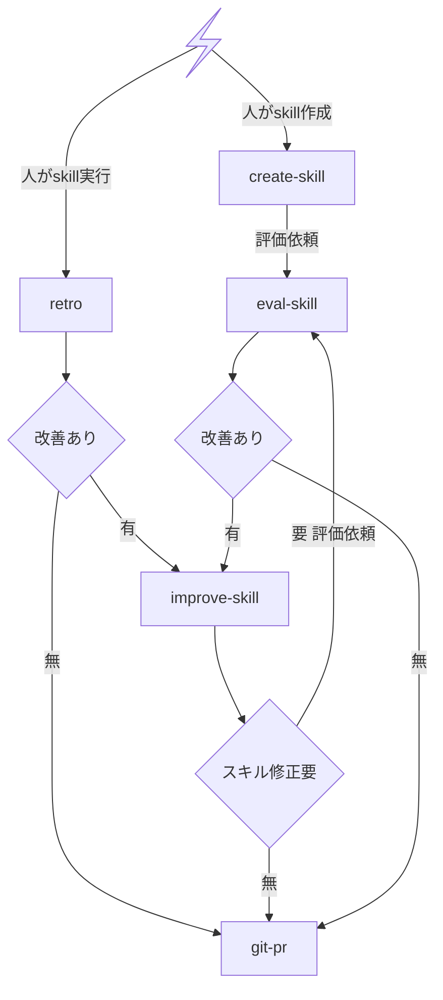

スキルループを見直し，AIエージェントに gitと .agents の操作権限あたえることにしたため，下記の SKILL.mdを改修したいです．

## 依頼内容
- eval-skill の評価レポート ， retro の kpi レポートをもとにスキルを改善する
- 評価レポート，kpi レポートのいずれかあればよい．
- eval-skill の評価レポートの保存先を `docs/eval-reports/skill-name/datetime.md`である
- retro の kpi レポートの保存先を `docs/retro-reports/skill-name/datetime.md`である
- 各レポートをもとにスキルを改善必要なら該当する`.agents/skills/skill-name/SKILL.md`を直で編集して，eval-skillで再評価をうける
    - 編集したら git commit する
- 改善不要なら git-create-pr スキルを使用する．
- ループは権限などエージェントに解決できない問題でなければ基本的には無限に行う

## スキル loop-design


## 修正してほしい SKILL.md

```markdown

```


