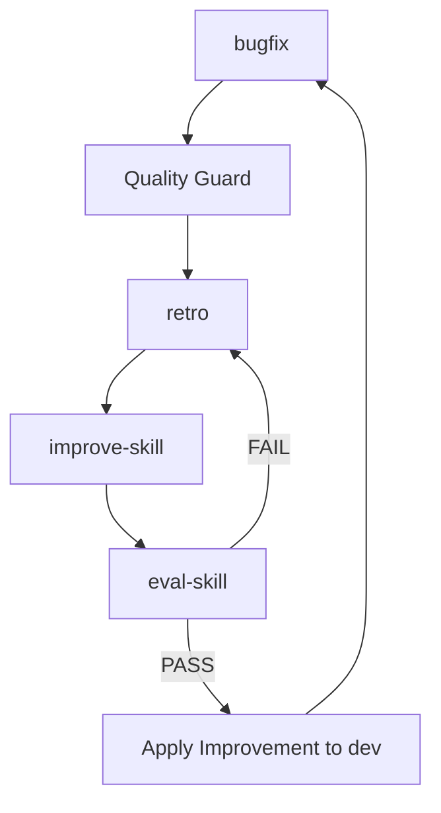

# Harness-Driven Development (HDD) Harness

This repository uses a self-evolving skill loop to continuously improve the quality of AI agent operations.

## Skill Loop Overview

The loop consists of four primary skills that work in a continuous cycle:

1.  **`bugfix`**: Standardizes the bug fixing process with mandatory reproduction tests and quality guards.
2.  **`retro`**: Performs a KPT (Keep, Problem, Try) analysis after every successful task.
3.  **`improve-skill`**: Analyzes "Try" items from retrospectives and proposes improvements to existing skills.
4.  **`eval-skill`**: Verifies the quality and safety of proposed skill improvements before they are adopted.

### The Cycle


## Skill Definitions

Due to environment restrictions, skills are located in `docs/skills/`.

- `docs/skills/bugfix.md`
- `docs/skills/eval-skill.md`
- `docs/skills/retro.md`
- `docs/skills/improve-skill.md`

## Quality Guards

All changes must pass the quality guard script:
```bash
./scripts/quality_guard.sh
```

The script runs:
- `cargo fmt --check`
- `cargo clippy`
- `cargo test`

## Git Workflow

- **Feature/Task Work**: Created from `dev` branch.
- **Merging to `dev`**: Automated by AI agents after passing all quality guards and skill evaluations.
- **Merging to `main`**: Manual PR review by humans.

## Documentation & Reports

- **Retrospectives**: `docs/retrospectives/`
- **Evaluation Reports**: `docs/dryrun-reports/`
- **Templates**: `docs/templates/`
